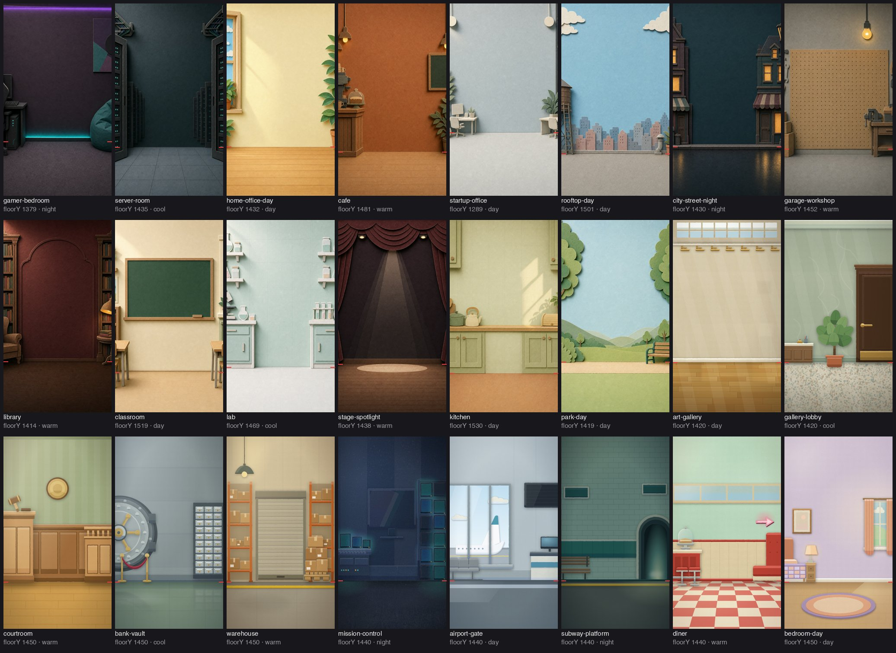

# papercut-explainer

Make short vertical explainer reels that look like layered construction paper, with the coding agent you already use doing the work: Claude Code, OpenCode, Codex, Gemini CLI, Cursor, Copilot and any other tool that reads Agent Skills.


*The bundled example reel ([`examples/hello-reel`](examples/hello-reel)), rendered from this repo. Silent placeholder voice, real captions, camera and cuts.*

This repo is two things that work together:

- **Nine agent skills** (the open `SKILL.md` format, so they load in most coding agents; see [Works with](#works-with)) that run the whole pipeline: strategy, hook, script, storyboard, voice, build, QA, and an installer. Ask for a reel, or run one stage on its own.
- **A Remotion library** the skills build on: a paper-cut component kit, 24 backdrops, 17 camera moves, 10 scene transitions, film-look layers, 79 sound effects and 8 music beds, plus the scripts that tie them into an episode.

You describe the video ("explain this repo in 25 seconds"). The skills research it, write a script on a fixed spoken spine, plan every camera move and cut, make or fake the voiceover, and build the scenes in Remotion. You review stills and the final cut.

## Contents

[What is in the box](#what-is-in-the-box) · [Install](#install) · [Use it](#use-it) · [Examples](#examples) · [How the workflow runs](#how-the-workflow-runs) · [Voice](#voice) · [Customising](#customising) · [Requirements](#requirements) · [Cost](#cost) · [Troubleshooting](#troubleshooting) · [Limits](#limits) · [Licence](#licence)

## What is in the box

| | |
|---|---|
| Skills | `papercut-explainer` (router), `papercut-setup`, `papercut-strategy`, `papercut-hook`, `papercut-script`, `papercut-storyboard`, `papercut-voice`, `papercut-build`, `papercut-qa` |
| Subagent | `papercut-scene`, a scene builder with only file and shell tools, so parallel scene agents start small |
| Backdrops | 24 paper-diorama sets at 1080×1920 with measured floor lines ([sheet](docs/img/backdrops.jpg)) |
| Camera | `OrbitCamera` + `Depth`, `SnapZoom`, `Crane`, `CrabTrack`, `DollyZoom`, `RackFocus`, `ForegroundPass`, `PullBack`, `FreezeFrame`, `PovMask`, `TimeRamp`, `DutchTilt`, `TiltShift`, `FocusPulse`, `FocusHunt`, `Handheld`, `CameraPush` |
| Cuts | `whip`, `zoomThrough`, `pageTurn`, `tearAway`, `tapePull`, `stampCut`, `infiniteZoom`, `popUpBook`, `keyhole`, `burnAway`, chained with `CutSeries` |
| Film look | gate weave and flicker, moving felt fibre, lens dirt, lamp flicker, halftone, graph paper |
| Overlays | taped headline banner, word-by-word torn caption tags, hook title, real-screenshot proof card with marker circles |
| Kit | 188 exports in `library/papercut/kit`: paper primitives (`Paper`, `Slab`, `Disc`, `Pill`, `Card`), a base critter with accessories, prop sets, rough UI rebuilds, a comment-keyword CTA scene |
| Sound | 79 synthesised SFX and 8 music beds, picked by name, rendered with Web Audio (no audio files to license) |
| Tools | scaffold, cue sheets, cached renders, QA contact sheets, catalog generator, placeholder narration, optional local TTS setup |

Each camera move and cut, with its props and when to use it, is in [`library/papercut/CATALOG.md`](library/papercut/CATALOG.md) (sections `paper/camera.tsx` and `paper/transitions.tsx`).



## Install

You need Node 20+, npm, ffmpeg, rsync and Python 3. Any coding agent in [Works with](#works-with) is the front end.

**With `npx skills`** (skills only, fastest):

```bash
npx skills add 0xS4N4TG/papercut-explainer
```

This installs the nine skills into your agents' skill folders (the CLI supports about 80 agents). It does not fetch the Remotion library or the scripts. Open your agent and say "set up papercut-explainer": `papercut-setup` clones the repo, asks how much you want (Minimal, Standard, Full) and installs it. Add `-g` for a user-wide install, `--skill papercut-hook` to take one skill.

**With git** (everything, including the library):

```bash
git clone https://github.com/0xS4N4TG/papercut-explainer
cd papercut-explainer
./install.sh
```

The installer asks how much you want to set up and does only that.

| Mode | What you get | Cost |
|---|---|---|
| **1. Minimal** | The skills, the scene-builder subagent and the config file. Strategy, hook, script, storyboard and style prompts work. Nothing renders. | seconds |
| **2. Standard** | Minimal, plus: a dependency check, the Remotion agent skills, a Python venv for QA sheets, and a self-test that scaffolds a project, typechecks it and renders a still. You can build and render full reels with a placeholder voice (silent, or macOS `say`). | about 0.7 GB (the first project's `node_modules`) and a few minutes |
| **3. Full** | Standard, plus local voiceover: a Qwen3-TTS venv, the model download, an ASR backend for word timings, and a smoke test that generates a line and checks the audio. | 4–6 GB more (1.5 GB venv plus a 2.3 or 4.2 GB model) |
| **4. Custom** | Pick any of: `skills`, `deps`, `remotion-skills`, `pytools`, `tts`, `verify`. | varies |

You can move up later: `./install.sh --mode custom --components deps,remotion-skills,pytools,verify`.

Non-interactive and scoped installs:

```bash
./install.sh --mode standard --yes                       # no questions
./install.sh --mode full --tts-model 0.6B --yes          # lighter voice model (2.3 GB)
./install.sh --mode minimal --project ~/code/my-videos   # skills for one project only
./install.sh --mode minimal --copy                       # copy skills instead of symlinking
./install.sh --dry-run --mode full                       # print what would happen
./install.sh --doctor                                    # check what is installed
./install.sh --uninstall                                 # remove the links it made
```

By default the installer looks for coding agents on your machine (`--target auto`; Claude Code if it finds none) and symlinks the skills into each one's skills folder, so a `git pull` updates them. Pick harnesses yourself with `--target claude,codex,gemini` (names in [Works with](#works-with)), or `--target all`. The installer writes `~/.config/papercut-explainer/config.env` with `PAPERCUT_LIB` and the Python paths it created; the library scripts and the skills read it. It never installs system packages (it prints the `brew` or `apt` line instead), replaces an identical existing skill folder (such as one from `npx skills add`) and moves a different one to `~/.config/papercut-explainer/backups/` instead of the skills folder, and does not touch your shell profile.

**The scene-builder subagent** (`papercut-scene`, which builds the scenes in parallel) is written as a copy per harness, in that harness's own format, with the model you choose. Rerun the installer to change it; `papercut-setup` asks.

```bash
./install.sh --mode minimal --target claude,opencode,codex --yes                       # defaults: Claude sonnet, others inherit the session model
./install.sh --mode minimal --target claude --claude-model opus --yes                  # opus | sonnet | haiku | inherit | a model id
./install.sh --mode minimal --target opencode --opencode-model anthropic/claude-sonnet-5-5 --yes
./install.sh --mode minimal --target codex --agent-model codex=<model-id> --yes        # any harness with file subagents
```

Prefer to let the agent do it? Open your agent in this folder and say **"set up papercut-explainer"**. The `papercut-setup` skill detects your agents, asks which mode and which scene-agent model you want, confirms any large download, runs the installer with the right flags and checks the result.

Install by hand: symlink or copy each folder in `skills/` into your agent's skills folder, then `export PAPERCUT_LIB="$PWD/library"`. For a subagent file, copy `agents/papercut-scene.md` (Claude Code) or `agents/opencode/papercut-scene.md` (OpenCode) and add the `model:` line yourself; Codex and Gemini files are generated by the installer.

## Works with

The skills are Agent Skills (`SKILL.md` folders with only `name` and `description` in the frontmatter, checked against the spec), so any agent that loads them works. The installer knows where each one looks:

| Harness | `--target` | Skills folder | Scene subagent file | Status |
|---|---|---|---|---|
| Claude Code | `claude` | `~/.claude/skills` | `~/.claude/agents/*.md` | In daily use |
| OpenCode | `opencode` | `~/.config/opencode/skills` | `~/.config/opencode/agents/*.md` | Skills, agent file and model line checked on 1.18; 2.x checked by the contributor who added it |
| Codex CLI | `codex` | `~/.agents/skills` | `~/.codex/agents/*.toml` | Paths and fields from OpenAI's docs; the TOML parses; not run in Codex |
| Gemini CLI | `gemini` | `~/.agents/skills` | `~/.gemini/agents/*.md` | Paths and fields from Google's docs; not run in Gemini CLI |
| Cursor, GitHub Copilot, Amp, Goose, Cline, Roo Code, Kilo Code, Zed, Factory Droid, Warp, Augment, Junie, OpenHands, Crush | `cursor` `copilot` `amp` `goose` `cline` `roo` `kilo` `zed` `droid` `warp` `augment` `junie` `openhands` `crush` | `~/.agents/skills` | none (Cursor, Copilot in VS Code and Goose read `~/.claude/agents` themselves) | Paths from each vendor's docs; not run |
| Kiro, Qwen Code, Windsurf | `kiro` `qwen` `windsurf` | `~/.kiro/skills`, `~/.qwen/skills`, `~/.codeium/windsurf/skills` | none | Paths from the vendors' docs or the `skills` CLI; not run |
| Anything else that reads `~/.agents/skills` | `agents` | `~/.agents/skills` | none | |
| Aider (no skills support) | none | | | Run `aider --read AGENTS.md`; the file points at the skills |

"Not run" means the folder and file format follow the vendor's documentation as of 17 Oct 2026 and the installer's output was checked for shape, but the agent itself wasn't started. If one breaks, [open an issue](../../issues) with the harness version. The table lives in [`harnesses.sh`](harnesses.sh): adding a harness is one line.

Harnesses without file subagents build the scenes themselves, one after another, or through their own parallel-task feature. The output is the same; it takes longer.

Opening this checkout in OpenCode finds the skills and the scene agent with no install (checked on 1.18; `.opencode/` and `opencode.jsonc` point at `skills/` and `agents/opencode/`). Agents that read a project's `.agents/skills` should find them through the `.agents/skills` link, which is untested. [`AGENTS.md`](AGENTS.md) covers agents that read that file instead.

## Models other than Claude (DeepSeek and others)

The skills are plain instructions, so any model that can call tools, read the QA stills (image input) and follow a long brief can run them. Weaker models cost more QA rounds. Nothing here has been run end to end on a non-Anthropic model by the maintainer, so treat these as starting points; DeepSeek's page for each agent is the authority: [api-docs.deepseek.com/quick_start/agent_integrations](https://api-docs.deepseek.com/quick_start/agent_integrations).

| Agent | What to do (DeepSeek model ids as of 17 Oct 2026: `deepseek-flash`, `deepseek-v4-pro`) |
|---|---|
| OpenCode | `/connect`, choose `deepseek`, paste your key. Then `./install.sh --target opencode --opencode-model deepseek/deepseek-flash --yes`. |
| Codex CLI | Add DeepSeek's `[model_providers.deepseek]` block to `~/.codex/config.toml` (their Codex page has it; prefer an env var for the key over a literal token). Then `./install.sh --target codex --agent-model codex=deepseek-flash --yes`. |
| Claude Code | Point it at DeepSeek's Anthropic-compatible endpoint with `ANTHROPIC_BASE_URL`, `ANTHROPIC_AUTH_TOKEN` and the `ANTHROPIC_DEFAULT_*_MODEL` variables from their Claude Code page. The scene agent's `model: sonnet` then resolves through `ANTHROPIC_DEFAULT_SONNET_MODEL`, so leave `--claude-model` alone. |

The same pattern works for any provider your agent supports: connect it in the agent, then pass its model id to `--opencode-model` or `--agent-model`.

## Use it

Open your agent in any folder you want the episode to live in and ask for a reel:

> Make a papercut explainer about https://github.com/example/echolark. 25 seconds, comment keyword PAPER.

The `papercut-explainer` skill takes the lead. It asks only for what is missing (the one claim the video proves, the audience level, what a commenter gets), then walks the stages below, handing each to its skill. Every stage writes a file, so you can stop, edit and resume.

You can also call one stage directly:

| Say | Skill | Writes |
|---|---|---|
| "set up papercut-explainer", "check my install" | `papercut-setup` | installed components, a `--doctor` report with the install level |
| "what should this reel be about? what format?" | `papercut-strategy` | the BRIEF block at the top of `research/facts.md`: topic, familiar format, audience, funnel |
| "write 5 hooks for this fact list" | `papercut-hook` | the HOOK block (SAY / WRITE / SHOW / ALIGN) at the top of `papercut/STORYBOARD.md` |
| "script this", "write the banner track" | `papercut-script` | `research/facts.md`, `narration/script.json`, the staging table (banner, set and gag per beat) in `STORYBOARD.md` |
| "storyboard this script" | `papercut-storyboard` | the camera and cut table, frame-level scene blocks and SFX plan in `STORYBOARD.md` |
| "set up the voice", "re-voice with another speaker" | `papercut-voice` | `narration/voice/`, `public/vo/captions.json`, `src/plan.json` |
| "scaffold the episode", "build scenes S03 to S06", "render it" | `papercut-build` | the project, `episode.json`, scenes, SFX cues, audio, `out/<name>.mp4` |
| "QA the reel", "check the stills" | `papercut-qa` | contact sheets, a pass/fail checklist, fixes |

Run modes the router offers at the start: full reel, script only, storyboard from a script you already have, style prompt for another tool (Sora, Runway, an image model), or fix one scene.

More prompts, with what each one loads and writes: [`examples/prompts.md`](examples/prompts.md).

### What works in which install mode

| Stage | Minimal | Standard | Full |
|---|---|---|---|
| Strategy, hook, script, storyboard, style prompts | yes | yes | yes |
| Scaffold, build scenes, SFX and music, stills QA, render to mp4 | no | yes, placeholder voice | yes |
| Voiceover from text, word-timed captions from real audio | no | placeholder timing only | yes |

If a stage needs more than you installed, the skill says so in one line and hands over to `papercut-setup` rather than improvising.

## Examples

| Example | What it is |
|---|---|
| [`examples/hello-reel`](examples/hello-reel) | A two-scene reel that runs through the real pipeline: script, placeholder narration, plan, scenes, SFX cues. It is what `library/tools/selftest.sh` builds and what the GIF above shows. |
| [`examples/paper-trail`](examples/paper-trail) | Every file one episode produces, for an invented product: BRIEF and facts with sources, HOOK block, script on the 10-beat spine, storyboard with camera and cut table, `episode.json`, cue sheet, `voice.json`. Read it to see what each stage hands the next. |
| [`examples/prompts.md`](examples/prompts.md) | Copy-paste prompts for every skill and for common edits. |

Run the first one yourself:

```bash
library/tools/selftest.sh ~/papercut-test     # builds it in a folder you keep
cd ~/papercut-test/series/episodes/01-selftest/papercut
npx remotion studio                            # scrub it
```

## How the workflow runs

```
 idea or link
     │
     ▼
 papercut-strategy ──► BRIEF            topic, "what show is this secretly?", audience, funnel
     │                 (top of research/facts.md)
     ▼
 papercut-hook ──────► HOOK block       SAY / WRITE / SHOW / ALIGN, tested before any scene exists
     │                 (top of papercut/STORYBOARD.md)
     ▼
 papercut-script ────► facts.md         every number traces to a sourced fact
     │                 script.json      75-95 words on a 10-beat spine
     │                 staging table    one visual-pun set per banner, one gag each
     ▼
 papercut-storyboard ► STORYBOARD.md    camera and cut table, frame-level events, SFX plan
     │
     ▼
 papercut-build ─────► project          scaffold from the template, episode.json
     │
     ▼
 papercut-voice ─────► voiceover.wav    local TTS, your own recording, or a placeholder
     │                 captions.json    word timings
     │                 plan.json        scene boundaries on word onsets
     ▼
 papercut-build ─────► scenes, audio, mp4    scene agents in parallel, cached renders
     │
     ▼
 papercut-qa ────────► stills + checklist, then fixes
```


The style has three tracks per beat: the voiceover tells the story, a taped banner states one hard fact the voiceover does not repeat, and a fresh paper set acts out the voiceover's concrete noun. Everything is paper (grain, rough cut edge, drop shadow, stacked shading), the camera moves through a diorama, and only the banner and labels boil in steps. The full rules live in [`skills/papercut-explainer/references/style-guide.md`](skills/papercut-explainer/references/style-guide.md).

State lives in files, not chat, so every stage can run in a fresh session. A series folder looks like this:

```
my-series/
  SERIES.md                   audience level, voice, palette, mascot, CTA style (optional)
  voice/voice.json            speaker and tempo (optional, for local TTS)
  papercut-assets/            textures and props laid over the library defaults (optional)
  episodes/01-slug/
    research/facts.md
    narration/script.json     [{"id": "l1_hook", "text": "..."}, ...]
    narration/voice/          takes, final lines, timing
    papercut/                 the Remotion project: episode.json, STORYBOARD.md, src/scenes, out/
```

## Voice

Three ways to get a voice, chosen by `papercut-voice` at the start:

1. **Local Qwen3-TTS** (Full install). `library/voice/setup_tts.sh` builds a venv, downloads the model and runs a smoke test. Apple Silicon uses `mps`, NVIDIA uses `cuda`, anything else falls back to CPU, which works but takes minutes per line. Generates three takes per line, picks by ASR match and pitch movement, trims, normalises to −16 LUFS and writes word timings. On an M-series Mac the smoke test line (4 s of audio) took 40 s including model load.
2. **Your own recording, or another TTS.** Drop takes in `narration/voice/takes/narrator/<line>_<n>.wav` and run `finalize.sh` (it needs an ASR backend for word timings).
3. **Placeholder.** `python3 library/tools/placeholder_vo.py` (from the narration folder) writes silent lines, or `--say` for the macOS voice, with word times spread over each line. Build and time the whole reel first, re-voice later: the scenes key off words, so the cues follow.

Details, the `voice.json` fields and the pickers: [`library/voice/README.md`](library/voice/README.md).

Cloning a voice needs a reference clip you have the right to use.

## Customising

- **Palette and mascot.** `library/papercut/kit/tokens.ts` holds the colour roles; `hero`/`heroLo` is the critter colour. `Critter` takes colour, accessory (cap, headset, monocle…), expression and a name pill. Per-series overrides go in an episode's own `src/theme.ts`; never edit the synced `src/lib/` copy in a project.
- **Backdrops.** Drop a 1080×1920 JPEG into `library/papercut/public/bg/backdrops/`, add its name, `floorY`, mood and `bestFor` to `backdrops.json`, then run `python3 library/tools/catalog.py`. Image prompts are in `skills/papercut-explainer/references/asset-prompts.md`; the code-drawn ones are in `library/papercut/backdrops-src/`.
- **Sound.** A new effect is one file, `library/audio/sfx/<name>.js`, whose first line is `// @sfx name | tags | seconds | description | origin`. A new mood is one JSON file in `library/audio/beds/`.
- **Fonts.** `library/papercut/kit/fonts.ts` loads local woff2 files, so renders never touch the network.
- **Giving back.** After an episode, `python3 library/tools/harvest.py <project>` lists what to promote into the library (`library/HARVEST.md`); then regenerate the catalogs.

Projects keep a snapshot of the kit in `src/lib/`, so an old episode renders the same after the library changes. Re-sync with `library/papercut/sync_kit.sh <project>` when you want the new version.

## Requirements

| | |
|---|---|
| OS | macOS (tested) or Linux (scripts are bash; not run end to end). Windows: use WSL. |
| Node, npm | Node 20+ |
| ffmpeg | 4.4+ on `PATH` |
| rubberband | only if you set a voice `tempo` other than 1.0 (`brew install rubberband`) |
| rsync | on `PATH` (kit sync) |
| Python | 3.9+ for the tools; 3.10–3.12 for the voice venv (the installer uses `uv` if you have it, else `python3.12`/`3.11`/`3.10`) |
| Chrome or Chromium | for the SFX and music render only (`CHROME_PATH` to override). Video renders use Remotion's own headless browser, downloaded on first render. |
| Disk | about 0.7 GB per project for `node_modules` (shared by APFS cloning on macOS; plain copy elsewhere, or set `DONOR`); 4–6 GB for local voice |
| A coding agent | any in [Works with](#works-with); the installer finds the ones you have (`--target`) |

## Cost

About **$14-19 in Claude API costs per 25-30 s reel**, at API list prices. Treat it as a yardstick, not a bill.

Nothing else is metered. The voice runs locally (or use the placeholder), and the 24 backdrops and all sounds ship in the repo. Make more backdrops and sounds as you need them: a backdrop is a 1080x1920 JPEG (from any image tool, or drawn in code like the sources in `library/papercut/backdrops-src/`) and a sound is one small JS file in `library/audio/sfx/`. Remotion is free for individuals and small teams (see [`THIRD_PARTY.md`](THIRD_PARTY.md)).

What moves the cost, largest first:

- **The lead session's context.** Every call re-reads the whole conversation. Start each episode in a fresh session, or compact before production starts. Strategy and research chat belong in a different session from the build.
- **Scene agents.** Fewer agents with 2-3 scenes each beat many agents with one. The bundled `papercut-scene` subagent has only file and shell tools, so each one starts small.
- **Effort level.** `high` is enough for scenes; `xhigh` costs noticeably more per scene.
- **Image reads.** Contact sheets at 200 px, one QA command per scene, two QA rounds at most.
- **Reading the kit source.** Agents read `papercut/CATALOG.md`, not the kit.

## Troubleshooting

`./install.sh --doctor` shows what is missing. The usual causes:

| Symptom | Fix |
|---|---|
| `node 18 (need 20+)` | Install Node 20 or newer. |
| `No Chrome/Chromium found` from `render.mjs` | Install Chrome, or set `CHROME_PATH`. Only the SFX and music render needs it. |
| Voice venv fails: no Python 3.10–3.12 | `brew install python@3.12`, or install [`uv`](https://docs.astral.sh/uv/) and rerun. |
| Model download stalls | Rerun `library/voice/setup_tts.sh`; finished files are kept. It already sets `HF_HUB_DISABLE_XET=1`. |
| First render is slow | Remotion downloads its headless browser (about 200 MB) once. |
| `--gl=angle` rejected | Edit the flag in `library/tools/render.py` and `qa.sh` for your Chrome build. |
| A skill does not trigger | Check the harness's skills folder (table in [Works with](#works-with)); `./install.sh --doctor` lists what it found. Restart Claude Code, Codex and Gemini CLI after installing; opencode reloads on its own. |
| opencode: "Configuration is invalid ... tools" | You have an old copy of the Claude agent file in an opencode folder. Rerun `./install.sh --target opencode`; it writes the opencode version. |

## Limits

- Written and run end to end on macOS (Apple Silicon). The CUDA and faster-whisper paths exist but were not run on real hardware.
- The voice pipeline is optional and the least tested part.
- `render.py` writes ProRes intermediates, several GB per episode in `out/cache`.
- Two-speaker dialogue helpers ship (`dialogue_timeline.py`, `SPEAKER`/`ROLE` options) with no template.
- The base `Critter` is a boxy creature with four leg stubs and two tall eyes. Swap its drawing in `kit/cast/Critter.tsx` if you want your own mascot.

## Licence

MIT for everything here except where [`THIRD_PARTY.md`](THIRD_PARTY.md) says otherwise. Remotion has its own licence (free for individuals and small teams, paid above a size threshold): read <https://www.remotion.dev/license> before using this commercially. Fonts are SIL OFL 1.1. The backdrops include AI-generated images; see the note in `THIRD_PARTY.md`.
